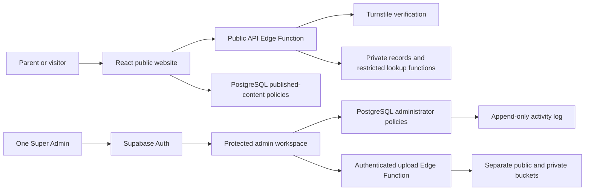

# Architecture and database design

Status: source implementation with local verification; live services are not connected.

The school owns a Vite/React/TypeScript application, a PostgreSQL database in its Supabase organization, Supabase Auth and Storage, and deployment in its own Vercel project. Tailwind and a shared stylesheet provide the design system. Lucide supplies icons. Bengali is the default; the language toggle persists across pages. No official school facts have been inferred from Facebook.

## Trust boundaries



The frontend contains only a publishable Supabase key. Every admin database operation requires an authenticated user listed in `admins`. A database uniqueness constraint permits exactly one administrator. The UI route guard improves usability; PostgreSQL policies enforce the actual authorization boundary. Public registration is disabled. User metadata cannot grant administrator privileges.

Public forms call the deployed `public-api` function. It validates the origin, request fields, Turnstile token and hostname, then applies a database-backed request limit keyed by a salted hash of the platform-forwarded IP address. Only the function's service role can execute admission, tracking and result RPCs. Origin restrictions alone are not authentication. No guardian identifiers are used as public result passwords.

Uploads call `upload`, which verifies the Auth token and administrator role, checks the bucket, file size, declared MIME and file signature, and assigns a generated filename. Storage policies separately enforce the administrator role. Signature checks are not malware scanning; keep untrusted documents private. SVG and HTML uploads are excluded. Public buckets are for public material only: unpublishing a content record does not revoke a public file URL.

## Data model

| Tables                | Purpose                                                                                                                         | Public access                                                 |
| --------------------- | ------------------------------------------------------------------------------------------------------------------------------- | ------------------------------------------------------------- |
| `settings`            | School branding, contact, admissions switch and SEO descriptions                                                                | Read only                                                     |
| `content`             | Welcome, history, mission, vision, objectives, facilities, achievements, infrastructure, academic highlights, timings, policies | Published records                                             |
| `people`              | Principal, assistant head, teachers, staff, committee                                                                           | Published records                                             |
| `notices`             | Categorized notices, attachments, pinning, scheduled publication                                                                | Published and publication time reached                        |
| `events`              | News, events, calendar                                                                                                          | Published records                                             |
| `gallery`             | Categorized photos and video                                                                                                    | Published records                                             |
| `academic_documents`  | Routines, syllabus, curriculum, forms, downloads                                                                                | Published records                                             |
| `classes`             | Grade, section, academic year                                                                                                   | Administrator only                                            |
| `students`            | Private student and guardian records; class and roll uniqueness                                                                 | Administrator only                                            |
| `admissions`          | Guardian applications, random tracking code, review state                                                                       | Administrator; restricted status-only lookup                  |
| `exams`               | Examination, academic year, class and date                                                                                      | Administrator only                                            |
| `results`             | Student/exam relation, validated subject marks, school-entered grade, random private access code, publication time              | Exact student ID + secret code through restricted lookup only |
| `attendance`          | One record per student/day, class consistency check                                                                             | Administrator only                                            |
| `contact_messages`    | Contact submissions and resolution status                                                                                       | Administrator only                                            |
| `admins`              | Single Auth user, role, editable display name                                                                                   | Current administrator only                                    |
| `activity_logs`       | Actor, operation, table, record ID and timestamp                                                                                | Administrator reads; triggers write                           |
| `private.rate_limits` | Hourly request counters                                                                                                         | Service function only                                         |

Foreign keys prevent accidental deletion of classes/students/examinations with related records. The result trigger checks student/exam class consistency, subject count, subject names and numeric score boundaries. Attendance validates the student's class. Result totals are computed from the returned subject marks; grades are entered according to the school's own policy, rather than assuming a national GPA rule.

## Application structure

```text
school-portal/
  src/
    App.tsx              public pages, reusable forms, protected admin modules
    lib.ts               client, schemas, module definitions, safe URL helper
    main.tsx             entrypoint
    styles.css           responsive design system
  public/                favicon, robots.txt, generated sitemap
  scripts/               secure admin invitation and build-time SEO
  supabase/
    config.toml
    migrations/          ordered schema/policy and storage migrations
    functions/public-api/ admission, contact, tracking, result requests
    functions/upload/    authenticated file validation/upload
  tests/                 form tests and PostgreSQL security/integrity tests
  docs/                  setup, Bengali manual, ownership and test reports
  .env.example
  vercel.json
  package.json
  package-lock.json
  DEVELOPMENT_PROGRESS.md
```

Content edits invalidate and reload public data in the same app session. A returning browser tab reloads data when focused. There is no service-role key or local fake-data fallback. Without service configuration, empty/setup states are displayed and submission is disabled. Simultaneous external visitors see edits on their next navigation reload/focus; realtime push subscriptions are not implemented.

The application is a client-rendered SPA. Page titles and descriptions update in the browser. Build-time domain sitemap generation is provided. Server-rendered per-page social previews and school identity metadata must be completed/tested during live release; social crawlers may not execute the client code. No production SEO claims are made.
